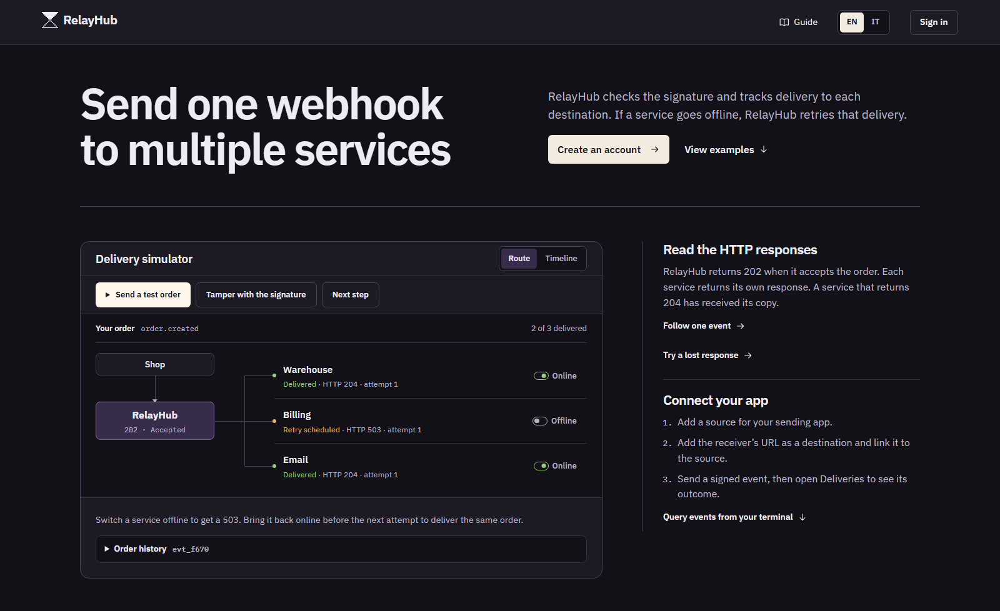

# RelayHub

**Signed webhook routing with a delivery history you can inspect and retry.**

RelayHub accepts signed JSON events, routes them to configured destinations, and delivers them in the background. Each organization has its own sources, destinations, roles, and delivery history.

[Open RelayHub](https://relayhub-webhooks.vercel.app) · [Delivery guide](https://relayhub-webhooks.vercel.app/guide) · [Start locally](#run-locally) · [API reference](docs/api.yaml) · [GitHub Actions](https://github.com/jacknegri89/RelayHub/actions/workflows/ci.yml)



The [homepage simulator](https://relayhub-webhooks.vercel.app/#simulator) follows a shop order to the warehouse, billing and email services. Switch billing offline, send an order, then bring it back online to watch just that delivery retry. **Route** shows the signature check, response code and attempt count for each service. **Timeline** follows the same order over time, and **Order history** lists the verification and delivery results. When paused or using reduced motion, **Next step** advances to its next delivery or retry. In the workspace, every delivery shows the trace for its real attempts.

Choose [**Try a lost response**](https://relayhub-webhooks.vercel.app/lost-response) to send one test order through the actual worker. Open both attempts and compare their delivery IDs with the receiver's count of requests and saved orders. [How the receiver handles the retry](docs/receiver-idempotency.md#try-a-lost-acknowledgement)

Before signing in, explore how Stripe, GitHub and Shopify use webhooks. GitHub repositories can send events directly to RelayHub. For Stripe and Shopify, verify the provider event in your own app and forward it using a RelayHub source.

### Connect a GitHub repository

1. In your RelayHub workspace, open **Sources**, create a **GitHub** source and copy its URL and one-time signing secret.
2. In the repository's **Settings → Webhooks → Add webhook**, paste the URL and secret, choose **application/json**, keep SSL verification enabled and select **Just the push event**. RelayHub acknowledges GitHub's initial ping without adding a dashboard event.
3. To forward pushes, link the source to a destination with event type `github.push`. Push a commit, open **Events** in RelayHub and match the external ID to the GUID in GitHub's **Recent deliveries**.
4. Use **Redeliver** on that push. GitHub sends the same GUID. While the event is retained, RelayHub returns its original ID with `duplicate: true` and creates no additional deliveries. [GitHub webhook deliveries](https://docs.github.com/en/webhooks/testing-and-troubleshooting-webhooks/redelivering-webhooks)

The default ingress limit is 256 KiB per request. Larger push payloads receive HTTP 413, visible in GitHub's delivery history.

In **Destinations**, select a day on the seven-day chart to see which attempts failed and how the receiver responded. Open an attempt’s delivery to follow later retries. **Alerts** records an outage after three consecutive failures and a recovery on the next 2xx response. Open a recovery to review the deliveries still failed from that outage. Owners and admins can select a group to retry.

Workspace members can subscribe to outage and recovery emails for individual destinations using their own account address. See [Destination email setup](docs/destination-email.md) to connect the mail service.

## Try the hosted app

Use the **EN / IT** switch to change the interface language. RelayHub remembers your choice in this browser and keeps partially filled forms in place.

1. Open the [registration page](https://relayhub-webhooks.vercel.app/register). Enter your name and email address, then choose a password of at least 12 characters.
2. Create an organization, then add a source and a destination. The **Destinations** page shows the built-in HTTPS verification receiver.
3. Link the source to the destination and send a signed event. Open **Events** or **Deliveries** to follow the recorded attempt through to HTTP 204.

Email is the sign-in identifier. Enable two-factor authentication under **Workspace → Security** and save the one-use recovery codes. On installations with account email enabled, verify your address in **Profile** to use **Forgot your password?**. A password reset signs out existing sessions. **Profile → Your personal data** also lets you export your account data or request account deletion. [Privacy](https://relayhub-webhooks.vercel.app/privacy) · [Cookies](https://relayhub-webhooks.vercel.app/cookies) · [Demo terms](https://relayhub-webhooks.vercel.app/terms) · [Account mail rollout](docs/operations.md#rolling-out-account-mail)

Organization owners can permanently remove a workspace in **Settings → Delete organization** by typing its exact name. RelayHub removes the organization and its delivery history, and members lose access to that workspace.

### Password recovery from your Gmail

You can send verification and password reset links from an existing personal Gmail address. After local setup, run the command below with your Google Desktop OAuth client file and your sender address. Open the Google consent link on the same computer. RelayHub requests permission to send email. The command saves the credentials in the local, Git-ignored `.env` file.

```sh
pnpm gmail:authorize --client-json "/path/to/google-desktop-client.json" --sender "you@gmail.com"
```

Set `RELAYHUB_MAIL_PROVIDER=gmail` and `RELAYHUB_ACCOUNT_EMAIL=1`, then restart the application. For a hosted installation, configure the same mail settings and OAuth credentials in the server's secret manager and set `RELAYHUB_BASE_URL` to the public HTTPS origin before sending links. To test, sign in, verify your address in **Profile**, then use **Forgot your password?** in a private browser window. [Gmail setup and token lifetime](docs/destination-email.md#send-from-an-existing-gmail-account)

The hosted portfolio uses Vercel, Neon and Upstash. Usage limits can interrupt background delivery or database access. The local Compose stack runs the full webhook demo with local PostgreSQL and Redis. [Free-tier limits and recovery](docs/operations.md#keeping-the-portfolio-demo-within-free-tiers)

## How a delivery works

| Stage   | What RelayHub records or verifies                                                                                   |
| ------- | ------------------------------------------------------------------------------------------------------------------- |
| Receive | Verifies the raw-body HMAC and timestamp. Deduplicates repeated submissions from the same source.                   |
| Route   | Matches event filters and commits the encrypted event, delivery records, and outbox entries together in PostgreSQL. |
| Deliver | A BullMQ worker signs the outgoing request and records the result. Transient failures use bounded retries.          |
| Inspect | Operators review attempts, delivery outcomes, and retries within their organization's workspace.                    |

Delivery is **at least once**. Each destination receives a stable `X-RelayHub-Delivery-Id`. Its v2 signature authenticates that ID and the event. The [receiver example](docs/receiver-idempotency.md) commits the receipt and the order together, including when the first HTTP acknowledgement is lost.

An organization owner can create and revoke read-only API keys in **Settings**. External tools can list events and deliveries, inspect their metadata and follow pagination. The [API Explorer](https://relayhub-webhooks.vercel.app/#api-explorer) shows how to configure the key and copy a request for your terminal. See the [OpenAPI reference](docs/api.yaml) for request and response schemas. For an Italian walkthrough of the e-commerce example, see [Dal negozio al gestionale](docs/esempio-ordine.md).

## Run locally

Use Node.js 24.16 or a compatible Node.js 26 release for the local configuration script, and Docker Compose v2 to run the stack. The image installs its own application dependencies. From the repository root, run:

```sh
node scripts/setup.mjs
docker compose -p relayhub-demo up --build -d --wait
```

Open [the local registration page](http://localhost:3000/register), choose a password of at least 12 characters, and create an organization. Local demo mode runs on loopback. The Compose migration service applies the schema before the web app and worker start.

Use `docker compose -p relayhub-demo stop` to stop the services and keep local data. The [Testing guide](docs/testing.md) covers seeded scenarios, retries, queue recovery, and running the application processes directly on your host.

To run tests from your host, install dependencies with `pnpm install --frozen-lockfile` and generate the Prisma Client with `pnpm generate`. Run `pnpm test` for unit tests. With the isolated services running, use `pnpm test:integration` for integration checks. Install Chromium with `pnpm exec playwright install chromium` before running `pnpm test:e2e`. Email tests use fictional recipients and a local mailbox. To rehearse recovery, follow the [encrypted backup and restore drill](docs/backup-restore.md).

## Documentation

| Guide                                       | What it covers                                                             |
| ------------------------------------------- | -------------------------------------------------------------------------- |
| [Architecture](docs/architecture.md)        | Request flow, the durable outbox, and recovery after failures              |
| [API reference](docs/api.yaml)              | Signed ingress, read APIs for events and deliveries, and outbound signing  |
| [Database](docs/database.md)                | Tenant boundaries, schema relationships, indexes, and retention            |
| [Operations](docs/operations.md)            | Environment variables, Vercel and Linux deployment, and key rotation       |
| [Testing](docs/testing.md)                  | Local and CI checks, test events, and production acceptance                |
| [Security model](docs/security.md)          | Authentication, signatures, encryption, isolation, and outbound networking |
| [Architecture decisions](docs/decisions.md) | Rationale behind the web, worker, and delivery models                      |

The Next.js application lives in `apps/web`, the BullMQ worker in `apps/worker`, and the Prisma schema and data layer in `packages/db`. For development, see [Contributing](CONTRIBUTING.md). For vulnerability disclosure, see [Security policy](SECURITY.md).

## Contributors

- [Giacomo Negri](https://github.com/jacknegri89) — Project owner and maintainer.
- [Claude](https://claude.com/claude-code) — UI design, interaction implementation, and browser verification.
- codex — Assisted with implementation, design, testing, and documentation.

The original code is published for portfolio review with rights reserved. Third-party packages retain their own licenses.
