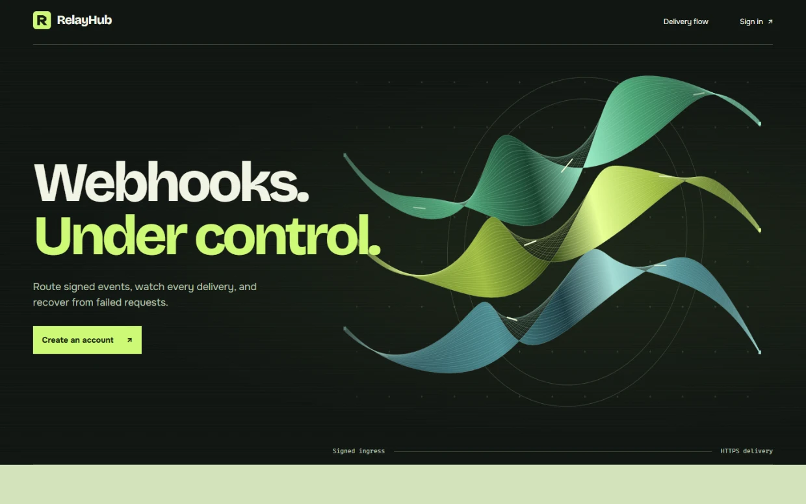

# RelayHub

**Signed webhook routing with a delivery history you can inspect and retry.**

RelayHub accepts signed JSON events, routes them to configured destinations, and delivers them in the background. Each organization has its own sources, destinations, roles, and delivery history.

[Open RelayHub](https://relayhub-webhooks.vercel.app) · [Start locally](#run-locally) · [API reference](docs/api.yaml) · [GitHub Actions](https://github.com/jacknegri89/RelayHub/actions/workflows/ci.yml)



The homepage simulator follows a shop order to the warehouse, billing and email services. Switch billing offline, send an order, then bring it back online to watch just that delivery retry. **Route** shows the signature check, response code and attempt count for each service. **Timeline** follows the same order over time. When paused or using reduced motion, **Next step** advances to its next delivery or retry. In the workspace, every delivery shows the trace for its real attempts.

Before signing in, explore how Stripe, GitHub and Shopify use webhooks. Each example follows a notification to the receiving app and links to the provider’s documentation. To forward a provider event through RelayHub, verify it in your app and sign a new request with the RelayHub source secret. Inside the workspace, each view has a short guide to the actions available to your role.

In **Destinations**, select a day on the seven-day chart to see which attempts failed and how the receiver responded. Open an attempt’s delivery to follow later retries. **Alerts** records an outage after three consecutive failures and a recovery on the next 2xx response. Open a recovery to review the deliveries still failed from that outage. Owners and admins can select a group to retry.

Workspace members can subscribe to outage and recovery emails for individual destinations using their own account address. See [Destination email setup](docs/destination-email.md) to connect the mail service.

## Try the hosted app

Use the **EN / IT** switch to change the interface language. RelayHub remembers your choice in this browser and keeps partially filled forms in place.

1. Open the [registration page](https://relayhub-webhooks.vercel.app/register). Enter your name and email address, then choose a password of at least 12 characters.
2. Create an organization, then add a source and a destination. The **Destinations** page shows the built-in HTTPS verification receiver.
3. Link the source to the destination and send a signed event. Open **Events** or **Deliveries** to follow the recorded attempt through to HTTP 204.

Email is the sign-in identifier. Enable two-factor authentication under **Workspace → Security** with an authenticator app, then save the one-use recovery codes. Verification and password-reset email require a configured mail transport. See [Privacy Policy](https://relayhub-webhooks.vercel.app/privacy), [Cookie Policy](https://relayhub-webhooks.vercel.app/cookies), and [Operations](docs/operations.md#vercel-deployment).

## How a delivery works

| Stage   | What RelayHub records or verifies                                                                                   |
| ------- | ------------------------------------------------------------------------------------------------------------------- |
| Receive | Verifies the raw-body HMAC and timestamp. Deduplicates repeated submissions from the same source.                   |
| Route   | Matches event filters and commits the encrypted event, delivery records, and outbox entries together in PostgreSQL. |
| Deliver | A BullMQ worker signs the outgoing request and records the result. Transient failures use bounded retries.          |
| Inspect | Operators review attempts, delivery outcomes, and retries within their organization's workspace.                    |

Delivery is **at least once**. Each destination receives a stable `X-RelayHub-Delivery-Id`. Its v2 signature authenticates that ID and the event. The [receiver example](docs/receiver-idempotency.md) commits the receipt and the order together, including when the first HTTP acknowledgement is lost.

An organization owner can create and revoke read-only API keys in **Settings**. External tools can list events and deliveries, inspect their metadata and follow pagination using the [OpenAPI reference](docs/api.yaml). For an Italian walkthrough of the e-commerce example, see [Dal negozio al gestionale](docs/esempio-ordine.md).

## Run locally

Use Node.js 24.16 or a compatible Node.js 26 release for the local configuration script, and Docker Compose v2 to run the stack. The image installs its own application dependencies. From the repository root, run:

```sh
node scripts/setup.mjs
docker compose -p relayhub-demo up --build -d --wait
```

Open [the local registration page](http://localhost:3000/register), choose a password of at least 12 characters, and create an organization. Local demo mode runs on loopback. The Compose migration service applies the schema before the web app and worker start.

Use `docker compose -p relayhub-demo stop` to stop the services and keep local data. The [Testing guide](docs/testing.md) covers seeded scenarios, retries, queue recovery, and running the application processes directly on your host.

## Documentation

| Guide                                       | What it covers                                                             |
| ------------------------------------------- | -------------------------------------------------------------------------- |
| [Architecture](docs/architecture.md)        | Request flow, the durable outbox, and recovery after failures              |
| [API reference](docs/api.yaml)              | Signed ingress, read APIs for events and deliveries, and outbound signing  |
| [Database](docs/database.md)                | Tenant boundaries, schema relationships, indexes, and retention            |
| [Operations](docs/operations.md)            | Environment variables, Vercel and Linux deployment, and key rotation       |
| [Testing](docs/testing.md)                  | Local and CI checks, test events, and production acceptance                |
| [Security model](docs/security.md)          | Authentication, signatures, encryption, isolation, and outbound networking |
| [Architecture decisions](docs/decisions.md) | Rationale behind the web, worker, and delivery models                      |

The Next.js application lives in `apps/web`, the BullMQ worker in `apps/worker`, and the Prisma schema and data layer in `packages/db`. For development, see [Contributing](CONTRIBUTING.md). For vulnerability disclosure, see [Security policy](SECURITY.md).

## Contributors

- [Giacomo Negri](https://github.com/jacknegri89) — Project owner and maintainer.
- [Claude](https://claude.com/claude-code) — Designed and built the spacetime redesign, its GSAP motion, and the browser checks.
- [Codex](https://github.com/openai/codex) — Assisted with implementation, design, testing, and documentation.

The original code is published for portfolio review with rights reserved. Third-party packages retain their own licenses.
