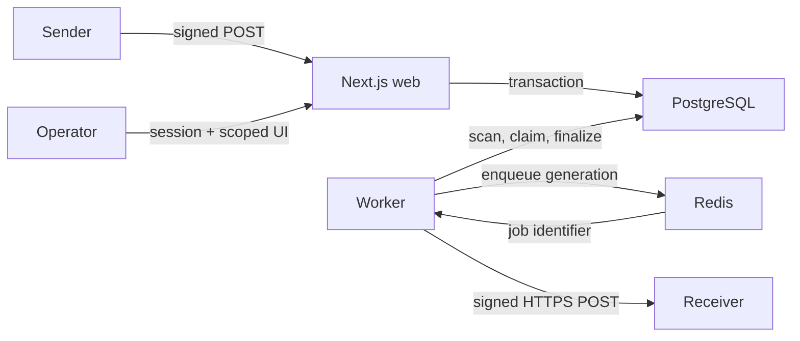

# Architecture

RelayHub runs a Next.js service for incoming requests and an independent Node.js worker for outbound delivery. PostgreSQL owns durable state. Redis carries scheduled job identifiers.

## Request flow

The web process authorizes configuration changes and verifies the literal bytes of an incoming webhook. An event, its distinct destinations and a scheduling row per delivery commit together. A successful ingress response confirms durable acceptance. It can precede dispatch and delivery.

Account email uses the web process. Destination incident notices use a PostgreSQL outbox consumed by the worker. Both use the same server-side sender with Resend or a local Mailpit inbox in demo mode. Reset and verification tokens stay out of BullMQ. Incident delivery retries preserve the original provider idempotency key. [Account security](security.md#account-enrollment) · [Notification delivery](destination-email.md)

The **Overview** compares the success rate of deliveries completed in the latest 24 hours with the preceding 24 hours. It divides delivered by delivered plus failed. Its P50, P95 and P99 describe the durations of individual attempts with a measured HTTP response. Transport timeouts count in the weekly attempt history and have no measured HTTP response. The in-progress count includes active deliveries of any age.

## Destination health

PostgreSQL observes the first completion of each outbound attempt in the worker’s fenced transaction. It serializes health updates on the destination row. Three consecutive failures open one incident across deliveries and retries. A 2xx response resets the streak and closes an open incident. Later failures start a new streak. Openings and recoveries share a sequence so two transitions in the same millisecond appear in order.

Every recorded HTTP response counts toward the daily success or failure total. An outbound transport failure with a measured duration also counts as a failure. Local policy blocks, disabled routes, expired leases and other attempts that never entered the transport leave the streak unchanged. Only timed HTTP responses contribute to mean response time. The workspace separates missing measurements from measured zeroes.

While a workspace tab is visible, it checks its organization’s alert summary every 30 seconds and checks again when the tab becomes visible. A change refreshes the workspace and its notification link. The summary endpoint checks session and membership and returns only the open count and latest transition. Members can also subscribe their own address to a destination’s transitions. See [Destination email setup](destination-email.md).

The failed-attempts view uses the UTC date selected on the chart. Several rows can belong to one delivery. The recovery view groups by delivery and checks its current failed state before scheduling a retry. A delivery already acknowledged by the destination stays out of the batch.

## Dispatch and recovery

The worker periodically reserves due scheduling rows by moving their publication time forward. BullMQ job IDs combine delivery ID and generation. The scheduling row stays in PostgreSQL until the attempt is finalized or a retry replaces its generation. An unsuccessful Redis publication or lost Redis job is repaired when the row becomes due again.

A conditional PostgreSQL update claims a pending, queued or retry-scheduled delivery and creates its attempt in the same transaction. Network I/O happens after commit. Finishing updates the same generation and lease token, preventing a stale worker from overwriting a newer result. Expired leases become recorded attempts and either use the remaining automatic budget or become failed.

| Crash boundary                                                               | Recovery                                                                    |
| ---------------------------------------------------------------------------- | --------------------------------------------------------------------------- |
| Before event commit                                                          | The sender can resubmit the same ID                                         |
| After commit before enqueue                                                  | The durable scheduling row gets republished                                 |
| After enqueue before claim                                                   | Queue deduplication and PostgreSQL republishing cover repeats and lost jobs |
| During a claimed attempt                                                     | The expired lease is recorded, then rescheduled if eligible                 |
| After the receiver processes a request but before PostgreSQL records success | A later attempt may resend the same stable Delivery ID                      |

The normal lease exceeds the outbound deadline. Process suspension or a network side effect after a disconnect can still overlap failures and retries. In this case at-least-once delivery requires receiver deduplication paired with its business write.

## Manual retry

An admin can retry failed deliveries. Each manual retry starts a new bounded budget, preserves history, and increments the generation. The worker uses the destination configuration in effect when it claims the retry. If the source or destination is disabled at claim time, the worker cancels the queued delivery. The dashboard reads PostgreSQL on navigation or refresh.
