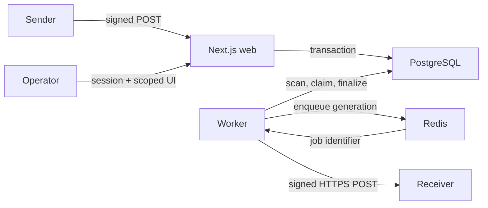

# Architecture

The web process authorizes configuration changes and verifies the literal bytes of an incoming webhook. An event, its distinct destinations and a scheduling row per delivery commit together. A successful ingress response confirms durable acceptance. It can precede dispatch and delivery.

Overview uses a rolling 24-hour window for events received, delivered, failed and mean successful attempt duration. The success rate is delivered divided by delivered plus failed. The in-progress count shows current active deliveries across all ages.

The worker periodically reserves due scheduling rows by moving their publication time forward. BullMQ job IDs combine delivery ID and generation. The scheduling row stays in PostgreSQL until the attempt is finalized or a retry replaces its generation. An unsuccessful Redis publication or lost Redis job is repaired when the row becomes due again.

A conditional PostgreSQL update claims a pending, queued or retry-scheduled delivery and creates its attempt in the same transaction. Network I/O happens after commit. Finishing updates the same generation and lease token, preventing a stale worker from overwriting a newer result. Expired leases become recorded attempts and either use the remaining automatic budget or become failed.

| Crash boundary                                                               | Recovery                                                                    |
| ---------------------------------------------------------------------------- | --------------------------------------------------------------------------- |
| Before event commit                                                          | The sender can resubmit the same ID                                         |
| After commit before enqueue                                                  | The durable scheduling row gets republished                                 |
| After enqueue before claim                                                   | Queue deduplication and PostgreSQL republishing cover repeats and lost jobs |
| During a claimed attempt                                                     | The expired lease is recorded, then rescheduled if eligible                 |
| After the receiver processes a request but before PostgreSQL records success | A later attempt may resend the same stable Delivery ID                      |

The normal lease exceeds the outbound deadline. Process suspension or a network side effect after a disconnect can still overlap failures and retries. In this case at-least-once delivery requires receiver deduplication paired with its business write.

An admin can retry failed deliveries. Each manual retry starts a new bounded budget, preserves history, and increments the generation. Failed retries use the destination configuration current at claim time. Disabled sources and destinations cause queued work to be cancelled when claimed. The dashboard is rendered from PostgreSQL and reflects state on navigation or refresh.
