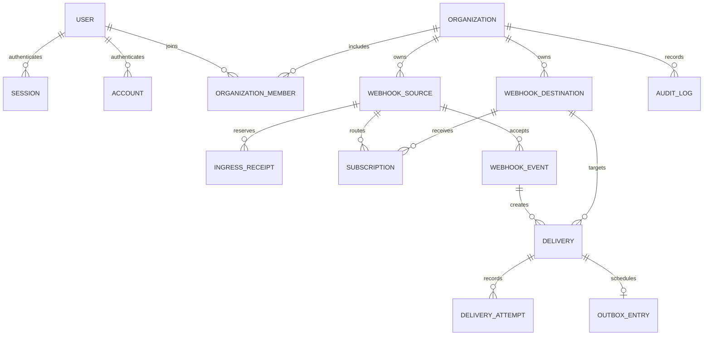

# Database

PostgreSQL stores accounts, configuration, events, delivery history, and pending work.

## Relationships

Auth models follow the Prisma adapter contract. Membership has a composite primary key and a user index. Composite foreign keys across organization-scoped relations prevent cross-tenant routes, events and deliveries at the database layer. Server queries also scope access using the membership of the current session.

Production invitations store a SHA-256 digest, expiry, and optional consumption timestamp. The registration handler claims each invitation atomically.

## Uniqueness and indexes

Events are unique by source and external ID. Ingress receipts temporarily reserve a hash of the signed request by source so an unsigned header cannot change the event ID on a previously observed signature. Deliveries are unique by event and destination. Attempts are unique by delivery and number.

List indexes start with organization ID and include timestamp and ID for deterministic ordering. The delivery status index supports dashboard filters. The outbox publication, delivery lease and expiry indexes support bounded scans. Search uses scoped substring matching and offset pagination. Revisit indexes for large organizations.

## Storage and retention

Encrypted envelopes contain a key ID, nonce, authentication tag, and ciphertext. Associated data binds each envelope to its resource type and ID. Timestamps use UTC. Disabling a source or destination preserves its historical references. The retention job removes terminal event trees and audit records after the configured period. It keeps active event trees until processing reaches a terminal state.
