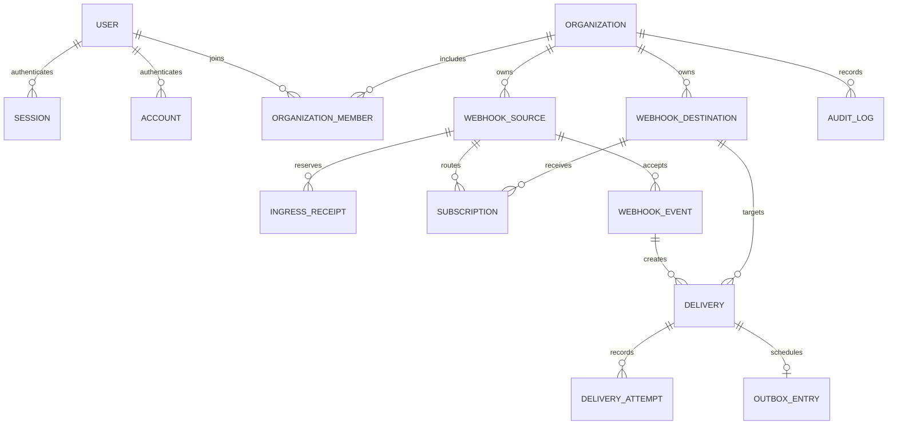

# Database

Auth models follow the Prisma adapter contract. Membership has a composite primary key and a user index. Composite foreign keys across organization-scoped relations prevent cross-tenant routes, events and deliveries at the database layer. Server queries also scope access using the membership of the current session.

Events are unique by source and external ID. Ingress receipts temporarily reserve a hash of the signed request by source so an unsigned header cannot change the event ID on a previously observed signature. Deliveries are unique by event and destination. Attempts are unique by delivery and number.

List indexes start with organization ID and include timestamp and ID for deterministic ordering. The delivery status index supports dashboard filters. The outbox publication, delivery lease and expiry indexes support bounded scans. Search uses scoped substring matching and offset pagination. Revisit indexes for large organizations.

Payloads and signing secrets contain key ID, nonce, authentication tag and encrypted bytes. AAD binds each envelope to the resource type and ID. Timestamps are interpreted in UTC. Source and destination records are disabled to preserve historical references. Retention removes terminal event trees and audit records older than the configured period. Nonterminal event trees are retained until processing reaches a terminal state.
